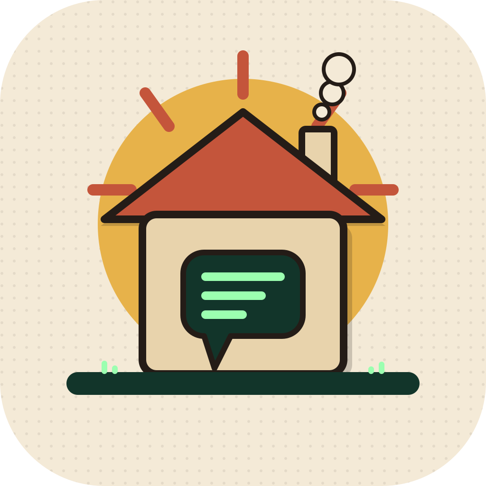

<p align="center">
  
</p>

<h1 align="center">Ragstead</h1>

<p align="center">
  <strong>Your documents stay home. Your questions get answers.</strong><br>
  A minimalist, self-hosted RAG chat app.
</p>

<p align="center">
  
  
  
  
</p>

<p align="center">
  <a href="#quick-start"><strong>Quick start</strong></a>
  ·
  <a href="#roadmap">Roadmap</a>
  ·
  <a href="LICENSE">License</a>
</p>

---

**Ragstead** is a small, local-first chat app for talking to your own documents. Everything runs in one Compose stack: Ollama for the model, FastAPI for the API, and plain HTML, CSS, and JavaScript for the interface. No framework in the retrieval path and no hosted service in the loop.

The name is **rag + stead** — a stead is a homestead, the place where things are kept and worked. Ragstead is where your knowledge lives and where your questions come to be answered, on your own machine.

## Why Ragstead?

Most RAG demos wrap a framework around a hosted API. Ragstead keeps the whole pipeline readable: the chunker, the embeddings call, the cosine ranking, and the prompt are a few hundred lines you can inspect and change. When an answer is wrong, you can see exactly which chunks were retrieved and why.

It is also deliberately small. There is no pipeline editor, no vector database to operate, and no telemetry. Upload a file, ask a question, read the cited answer, move on.

## Features

### Chat

- Conversations stream token by token over Server-Sent Events.
- Every answer cites the chunks it used, with source file and chunk number.
- A sidebar of chats with titles, timestamps, and full history.
- Click any earlier chat to resume it exactly where you left off.

### Temporary uploads

- Drop a file into a single chat and ask about it immediately.
- The file is chunked and indexed for that chat only.
- It is deleted when the chat is deleted, when its TTL expires, or during the startup sweep.
- Temporary files never leak into a knowledge library.

### Knowledge libraries

- Named, persistent collections of documents.
- Ingest once, then attach the library to any chat.
- Detach a library without deleting it; the documents stay available for other chats.

### Retrieval, from scratch

- Own token-aware chunker that prefers paragraph and sentence boundaries.
- Embeddings from Ollama, stored as float32 blobs in SQLite.
- Top-k cosine similarity in NumPy, de-duplicated by document.
- Numbered context blocks in the prompt, so citations map back to real chunks.

## Quick start

Requirements: Docker Desktop (or Docker Engine with Compose v2) and enough RAM to run the chat model. 8 GB is a comfortable minimum.

```bash
git clone https://github.com/alouiadel/ragstead.git
cd ragstead
docker compose up
```

Open <http://localhost:8000>.

The first run pulls the chat and embedding models into the `ollama-data` volume. It takes a few minutes and needs network access; later runs work offline.

```bash
# Pull a different model into the running stack
docker compose exec ollama ollama pull qwen2.5:7b
```

All settings are optional and read from the environment or a `.env` file beside `docker-compose.yml`.

| Variable          | Default               | Description                                     |
| ----------------- | --------------------- | ----------------------------------------------- |
| `CHAT_MODEL`      | `llama3.2`            | Ollama model used for generation                |
| `EMBED_MODEL`     | `nomic-embed-text`    | Ollama model used for embeddings                |
| `OLLAMA_BASE_URL` | `http://ollama:11434` | Ollama endpoint as seen from the backend        |
| `CHUNK_SIZE`      | `800`                 | Target chunk size, in characters                |
| `CHUNK_OVERLAP`   | `120`                 | Overlap between consecutive chunks              |
| `TOP_K`           | `5`                   | Chunks retrieved per query                      |
| `MAX_UPLOAD_MB`   | `20`                  | Per-file upload limit                           |
| `TEMP_FILE_TTL_H` | `24`                  | Hours before an unused temporary upload expires |
| `DATA_DIR`        | `/data`               | SQLite database and uploaded files              |

## Roadmap

- [x] Name, logo, license, README
- [ ] Chat CRUD with streaming responses
- [ ] Temporary per-chat uploads with TTL cleanup
- [ ] Knowledge libraries and per-chat attachment
- [ ] PDF, Markdown, and plain-text ingestion
- [ ] Inline citations with a source panel
- [ ] Docker Compose stack with Ollama
- [ ] Reranking pass over top-k candidates
- [ ] Chat export (Markdown)

The app icon is generated from `assets/logo.svg` with `./scripts/make-icon.sh` (requires macOS `sips`).

## License

[MIT](LICENSE) © 2026 Adel Aloui
