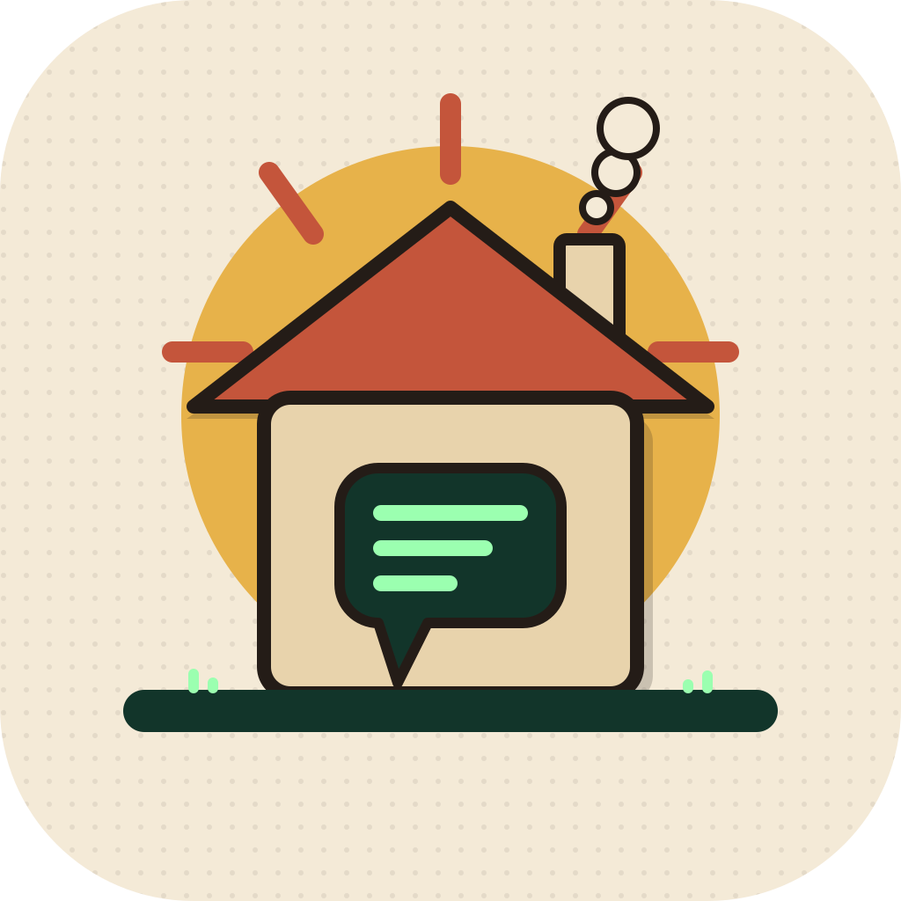

<p align="center">
  
</p>

<h1 align="center">Ragstead</h1>

<p align="center">
  <strong>Your documents stay home. Your questions get answers.</strong><br>
  A minimalist, self-hosted RAG chat app.
</p>

<p align="center">
  
  
  
  
  
  
  
</p>

---

**Ragstead** is a small, local-first chat app for talking to your own documents. llama.cpp serves the models, FastAPI serves the API, and the UI is plain HTML, CSS, and JavaScript. The retrieval pipeline is written from scratch, so when an answer is wrong you can see exactly which chunks were retrieved and why.

The name is **rag + stead**: a stead is a homestead, the place where things are kept and worked, which is what this is for your knowledge.

## Quick start

Requires Python 3.12+ and [llama.cpp](https://github.com/ggml-org/llama.cpp) with `llama-server`. The default models are small, so a few GB of free RAM is enough.

```bash
git clone https://github.com/alouiadel/ragstead.git
cd ragstead
pip install -r req.txt
uvicorn backend.main:app --port 8000
```

Serve your chat and embedding GGUF models with `llama-server`, point Ragstead at them with the variables below, and open <http://localhost:8000>. Once the models are on disk, everything runs offline.

| Variable      | Default            | Description                         |
| ------------- | ------------------ | ----------------------------------- |
| `CHAT_MODEL`  | `lfm3`             | Chat model served by llama.cpp      |
| `EMBED_MODEL` | `embeddinggemma-2` | Embedding model served by llama.cpp |
| `TOP_K`       | `5`                | Chunks retrieved per query          |
| `DATA_DIR`    | `data/`            | SQLite database and uploaded files  |

Set any of them in the environment or a `.env` file at the project root.

## License

[MIT](LICENSE) © 2026 Adel Aloui
